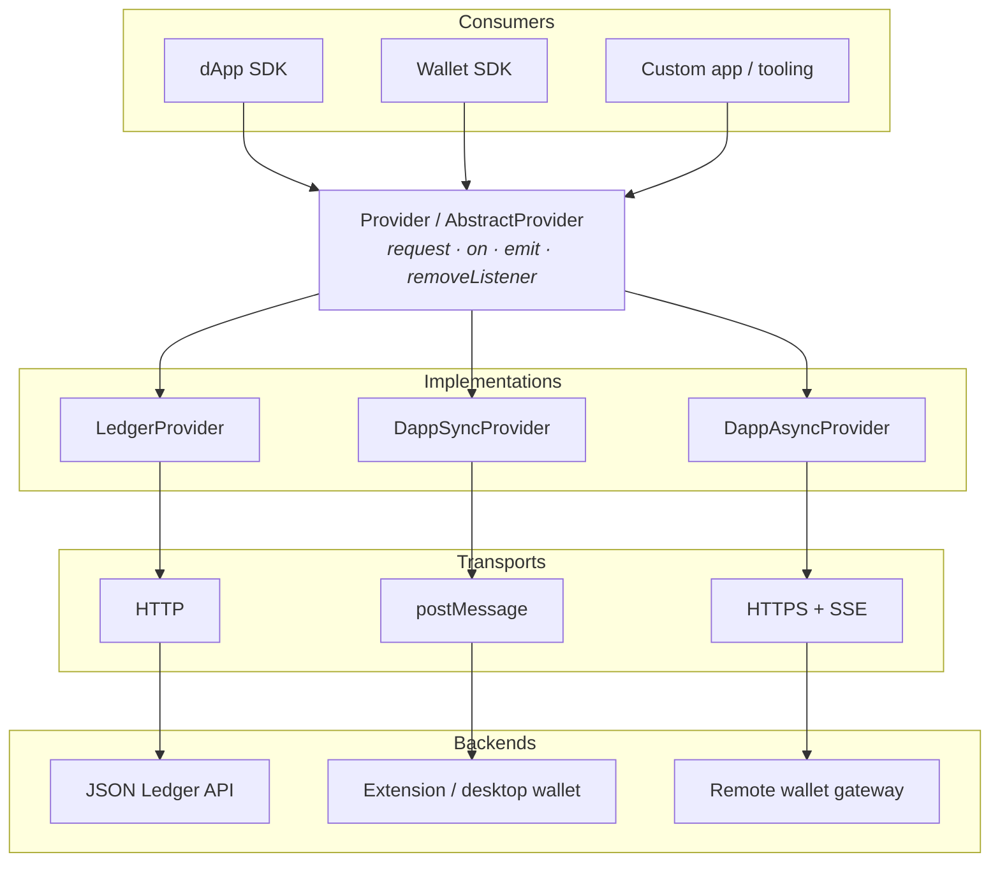

# @canton-network/core-splice-provider

Shared **Provider** abstraction for talking to a Canton ledger — either directly (JSON Ledger
API) or through a wallet / dApp API.

Consumers never call the ledger or a specific transport themselves. They use one interface:

```ts
import {
    AbstractProvider,
    Provider,
} from '@canton-network/core-splice-provider'
```

The shape follows [EIP-1193](https://eips.ethereum.org/EIPS/eip-1193) (`request` + events)
without Ethereum method semantics. Concrete APIs are defined elsewhere — for example
[CIP-103](https://github.com/canton-foundation/cips/blob/main/cip-0103/cip-0103.md) for dApps
and the Canton JSON Ledger API for direct access.

Published on [npm](https://www.npmjs.com/package/@canton-network/core-splice-provider) under
Apache-2.0.

## Install

```bash
npm install @canton-network/core-splice-provider
```

## Goals

- **One interface** for direct ledger access and wallet-mediated access
- **Transport agnostic** — HTTP, `postMessage`, SSE, in-process, or anything else
- **Auth agnostic** — implementations choose how credentials are obtained
- **Request + events** — `request` for RPC-style calls; `on` / `removeListener` / `emit` for streams
- **Typed methods** — params and results inferred from the method name
- **Small surface** — easy to reimplement in other languages; transport-specific providers can be published separately

What this package does **not** define: which LAPI or dApp methods exist, how authentication
works, or wallet / UI behaviour. Those belong to specs, codegen, and concrete providers.



## Provider interface

```ts
import type { RequestArgs, UnknownRpcTypes } from '@canton-network/core-types'

export type EventListener<T> = (...args: T[]) => void

export interface Provider<T extends UnknownRpcTypes> {
    request<M extends keyof T>(args: RequestArgs<T, M>): Promise<T[M]['result']>

    on<E>(event: string, listener: EventListener<E>): Provider<T>
    emit<E>(event: string, ...args: E[]): boolean
    removeListener<E>(
        event: string,
        listenerToRemove: EventListener<E>
    ): Provider<T>
}
```

The interface does not assume which methods are supported, how authentication works, or
whether calls go through a wallet — only a typed `request` and an event bus.

### `AbstractProvider`

Implements the event map (`on` / `emit` / `removeListener`) and leaves `request` abstract:

```ts
export abstract class AbstractProvider<
    T extends UnknownRpcTypes,
> implements Provider<T> {
    abstract request<M extends keyof T>(
        args: RequestArgs<T, M>
    ): Promise<T[M]['result']>

    // on / emit / removeListener provided
}
```

Subclasses wire `request` to their transport (HTTP JSON LAPI, window `postMessage`, HTTPS +
SSE, and so on).

## Typing model

Every call is keyed by a method name `M`. Params come from `C[M]['params']` and the result
from `C[M]['result']`. Helpers live in [`@canton-network/core-types`](../types):

```ts
type UnknownRpcTypes = {
    [method: string]: {
        params: unknown
        result: unknown
    }
}

type RequestArgs<
    T extends UnknownRpcTypes,
    M extends keyof T,
> = T[M]['params'] extends never
    ? { method: M }
    : { method: M; params: T[M]['params'] }
```

Specs usually come from **OpenRPC** (JSON-RPC style) or **OpenAPI** (Ledger API). Codegen
produces TypeScript models; providers map them into this `params` / `result` shape.

### OpenRPC (dApp API)

Map each method to params and result. Use `params: never` when a method takes no arguments:

```ts
type DappClient = {
    prepareExecute: {
        params: PrepareExecuteParams
        result: PrepareExecuteResult
    }
    status: {
        params: never
        result: StatusResult
    }
}

class DappProvider implements Provider<DappClient> {
    async request<M extends keyof DappClient>(
        args: RequestArgs<DappClient, M>
    ): Promise<DappClient[M]['result']> {
        // dispatch via transport…
    }
}

await provider.request({ method: 'status' })
await provider.request({
    method: 'prepareExecute',
    params: {/* PrepareExecuteParams */},
})
```

### OpenAPI (Ledger API)

Ledger access is exposed as one RPC-style method, `ledgerApi`, whose params encode the HTTP
operation (`resource`, `requestMethod`, optional `body` / `path` / `query`).

For per-operation type safety, each Ledger API operation is a distinct member of a union.
TypeScript narrows params and results from `resource` + `requestMethod` (you can also pass an
explicit operation type argument):

```ts
type LedgerClient =
    | {
          ledgerApi: {
              params: {
                  resource: '/v2/parties'
                  requestMethod: 'get'
                  query: { /* … */ }
              }
              result: ListKnownPartiesResponse
          }
      }
    | {
          ledgerApi: {
              params: {
                  resource: '/v2/parties'
                  requestMethod: 'post'
                  body: AllocatePartyRequest
              }
              result: AllocatePartyResponse
          }
      }
    | /* … */
```

Stock OpenAPI codegen does not emit this shape; a dedicated generator produces the
provider-oriented operation types used by
[`@canton-network/core-provider-ledger`](../provider-ledger).

## Implementations

| Package                                                      | Class               | Access model                       | Typical transport             |
| ------------------------------------------------------------ | ------------------- | ---------------------------------- | ----------------------------- |
| [`@canton-network/core-provider-ledger`](../provider-ledger) | `LedgerProvider`    | Direct JSON LAPI                   | HTTP                          |
| [`@canton-network/core-provider-dapp`](../provider-dapp)     | `DappSyncProvider`  | CIP-103 Sync (extension / desktop) | `postMessage` / window bridge |
| [`@canton-network/core-provider-dapp`](../provider-dapp)     | `DappAsyncProvider` | CIP-103 Async (remote / custody)   | HTTPS + SSE                   |

Higher-level SDKs (`@canton-network/dapp-sdk`, `@canton-network/wallet-sdk`) sit on these
providers so app code keeps the same interface for local and remote wallets.

### Minimal custom provider

```ts
import { AbstractProvider } from '@canton-network/core-splice-provider'
import { RequestArgs } from '@canton-network/core-types'

type MyRpc = {
    ping: { params: { message: string }; result: string }
}

class MyProvider extends AbstractProvider<MyRpc> {
    async request<M extends keyof MyRpc>(
        args: RequestArgs<MyRpc, M>
    ): Promise<MyRpc[M]['result']> {
        if (args.method === 'ping') {
            return `pong:${args.params.message}` as MyRpc[M]['result']
        }
        throw new Error('Unsupported method')
    }
}

const provider = new MyProvider()
provider.on('ready', () => console.log('ready'))
await provider.request({ method: 'ping', params: { message: 'hi' } })
```

## Events

`AbstractProvider` maintains an in-memory listener map:

- `on(event, listener)` — register
- `removeListener(event, listener)` — unregister
- `emit(event, …args)` — notify; returns `false` if nobody is listening

Event names and payloads come from the concrete API (for example CIP-103 `statusChanged`,
`accountsChanged`, `txChanged`, plus Async-only `connected` and `messageSignature`). This
package only provides the subscription machinery.

## Errors

Implementations should expose a consistent error shape (code + message) regardless of
transport, normalizing underlying JSON Ledger API / JSON-RPC failures where needed. dApp
providers typically follow EIP-1193 / EIP-1474-style codes; see the
[dApp SDK errors reference](../../docs/dapp-sdk/reference/errors.mdx).

## Exports

| Export                | Description                                 |
| --------------------- | ------------------------------------------- |
| `Provider<T>`         | Typed provider interface                    |
| `AbstractProvider<T>` | Base class with events; implement `request` |
| `EventListener<T>`    | Listener callback type                      |

RPC map helpers (`UnknownRpcTypes`, `RequestArgs`) are in `@canton-network/core-types`.

## Related packages

| Package                                                      | Role                           |
| ------------------------------------------------------------ | ------------------------------ |
| [`@canton-network/core-types`](../types)                     | Shared RPC typing helpers      |
| [`@canton-network/core-provider-ledger`](../provider-ledger) | Direct ledger provider         |
| [`@canton-network/core-provider-dapp`](../provider-dapp)     | Sync / Async dApp providers    |
| [`@canton-network/core-rpc-transport`](../rpc-transport)     | Transports used by RPC clients |
| [`@canton-network/dapp-sdk`](../../sdk/dapp-sdk)             | High-level dApp SDK            |
| [`@canton-network/wallet-sdk`](../../sdk/wallet-sdk)         | Wallet SDK                     |
